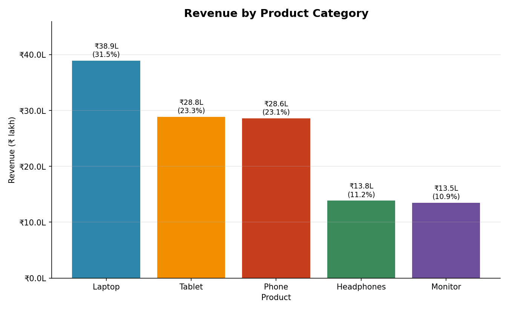
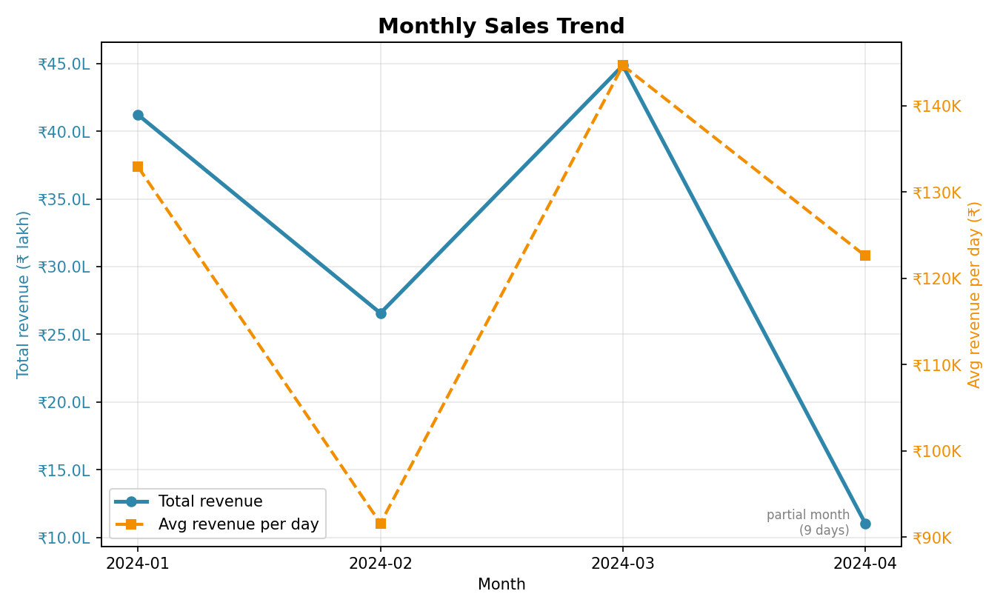
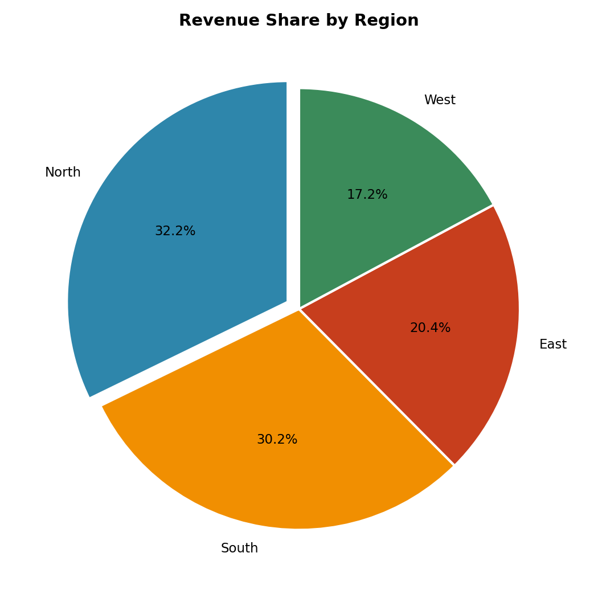
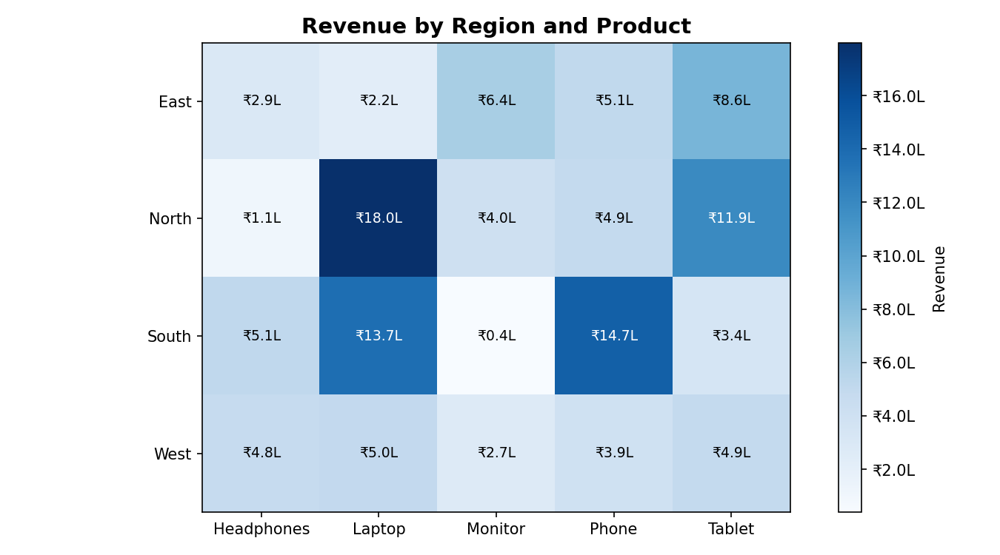
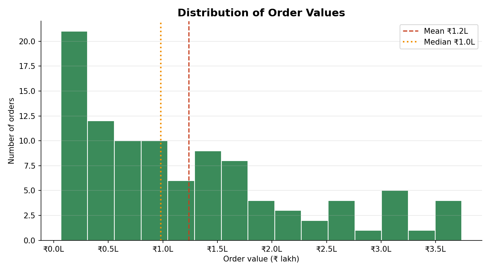

# Week 4 – E-commerce Sales Analysis

A complete data analysis project: **load → clean → analyze → visualize → report**, built with Python, pandas and matplotlib on the Week 4 `sales_data.csv` dataset (100 orders, Jan–Apr 2024).

## Project Overview

**Goal:** understand where revenue comes from and turn the numbers into business recommendations.

**Questions answered**

1. How much revenue did the store make, and what is a typical order worth?
2. Which products and regions drive the most revenue?
3. How do sales change month to month?
4. Which product sells best in which region?

**Headline results**

| Metric | Value |
|---|---|
| Total revenue | ₹1,23,65,048 |
| Orders / units sold | 100 / 478 |
| Average order value | ₹1,23,650 (median ₹97,956) |
| Best product | Laptop – 31.5% of revenue |
| Best region | North – 32.2% of revenue |
| Weakest region | West – 17.2% of revenue |
| Slowest month | Feb 2024 – revenue per day 37% below March |

Full findings are in [`report/analysis_report.md`](report/analysis_report.md).

## Project Structure

```
week4-ecommerce-sales-analysis/
├── README.md
├── main.py                     # full pipeline (load, clean, analyze, visualize, report)
├── requirements.txt
├── data/
│   └── sales_data.csv          # dataset provided for Week 4
├── visualizations/             # generated charts (PNG)
│   ├── 1_revenue_by_product_bar.png
│   ├── 2_monthly_trend_line.png
│   ├── 3_region_share_pie.png
│   ├── 4_region_product_heatmap.png
│   └── 5_order_value_histogram.png
├── report/
│   ├── analysis_report.md      # written report with insights + recommendations
│   └── summary_tables.xlsx     # grouped tables (product, region, month, region×product)
├── screenshots/
│   └── terminal_output.png     # program run + test results
└── tests/
    └── test_analysis.py        # 16 pytest tests
```

## Setup Instructions

1. Install Python 3.9 or newer.
2. Clone the repository and move into it:
   ```bash
   git clone <your-repo-url>
   cd week4-ecommerce-sales-analysis
   ```
3. (Optional) create a virtual environment:
   ```bash
   python -m venv venv
   source venv/bin/activate      # Windows: venv\Scripts\activate
   ```
4. Install dependencies:
   ```bash
   pip install -r requirements.txt
   ```
5. Run the analysis:
   ```bash
   python main.py
   ```
   Charts are written to `visualizations/` and the report to `report/`.
   To use a different file: `python main.py --data path/to/file.csv --out output_folder`
6. Run the tests:
   ```bash
   python -m pytest -v
   ```

## Technical Details

### Pipeline

| Step | Function | What it does |
|---|---|---|
| Load | `load_data()` | Reads the CSV; raises a clear error if the file is missing, empty, or lacks required columns |
| Clean | `clean_data()` | Trims text and fixes casing, converts dates and numbers (bad values → NaN), removes duplicates, drops rows missing key fields or with quantity/price ≤ 0, recomputes `Total_Sales` when it is missing or ≠ `Quantity × Price`, adds a `Month` column |
| Analyze | `analyze()` | `groupby` aggregations by product, region and month; a region × product `pivot_table`; headline metrics (totals, mean/median order value, correlation) |
| Visualize | `create_visualizations()` | 5 matplotlib charts (bar, line, pie, heatmap, histogram) |
| Report | `write_report()`, `generate_insights()` | Markdown report and Excel summary; insights are generated from the numbers, so they update if the data changes |

### Chart choices

| Chart | Type | Why this type |
|---|---|---|
| Revenue by product | Bar | Comparing categories |
| Monthly trend | Line | Showing change over time. Revenue per day is plotted too, because April has only 9 days of data |
| Revenue share by region | Pie | Parts of a whole (4 slices – easy to read) |
| Region × product | Heatmap | Two categories at once |
| Order values | Histogram | Shape of the distribution; mean vs median shows skew |

### Data structures

- **pandas DataFrame** for the cleaned order data.
- **Grouped DataFrames** (`by_product`, `by_region`, `by_month`) and a **pivot table** (`region_product`) for chart inputs.
- A **dict of metrics** passed to the report and insight functions.

### Error handling

- Custom `DataValidationError` for bad input; `main.py` exits with a clear message instead of a stack trace.
- `pd.to_datetime(..., errors="coerce")` / `pd.to_numeric(..., errors="coerce")` so one bad value does not crash the run.
- Excel export is skipped with a warning if `openpyxl` is not installed.

## Testing Evidence

`tests/test_analysis.py` has 16 tests:

- **Loading:** correct shape, missing file, missing columns, empty file, header-only file
- **Cleaning:** real data unchanged, correct dtypes, a deliberately dirty sample (whitespace, duplicates, missing/wrong totals, bad dates, negative and non-numeric quantities), all-invalid input
- **Analysis:** total revenue, best product/region, shares sum to 100%, group totals match overall total, partial month detected, insights generated
- **End-to-end:** full pipeline creates 5 charts and a report

```
$ python -m pytest -v
...
============================== 16 passed ==============================
```

## Visualizations







## Key Insights

1. **Laptop leads revenue (31.5%)** even though Tablet had more orders – Laptop orders are larger (~₹1.62L each).
2. **Headphones and Monitors** together bring in only 22.1% of revenue.
3. **North + South = 62.4% of revenue.** West is weakest (17.2%) despite 26 orders – its average order is only ~₹81.7K.
4. **Laptop in North** is the strongest region-product pair (₹18.0L).
5. **February was the slowest month** – revenue per day 37% below March.
6. **Mean order (₹1.24L) > median (₹0.98L)** – a few large orders pull the average up.

## What I Learned

- Building a full analysis pipeline as separate, testable functions
- Choosing the right chart type for the question (comparison, trend, share, distribution)
- Why comparing a partial month on totals is misleading, and normalising by days fixes it
- Validating data and handling bad input without crashing
- Writing tests for data code with small hand-made CSVs
