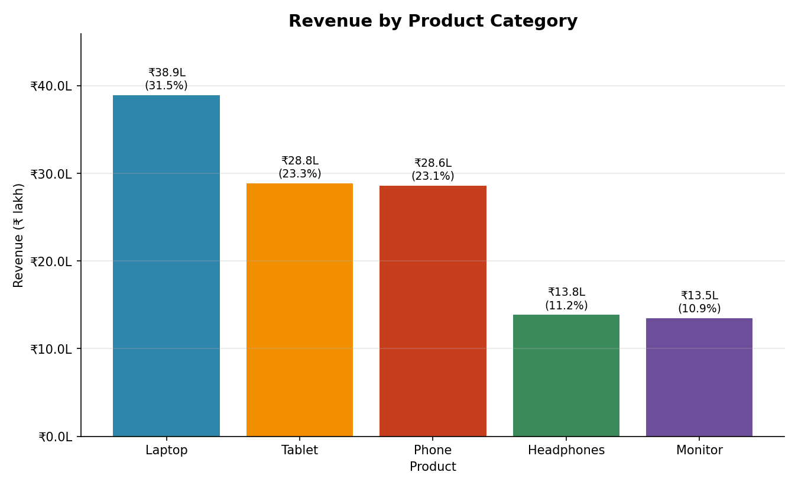
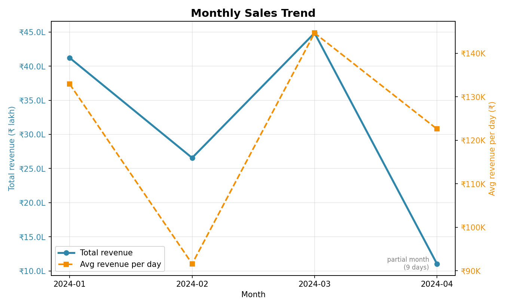
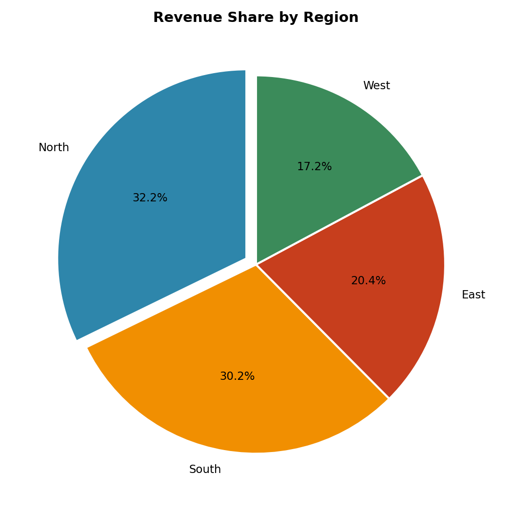
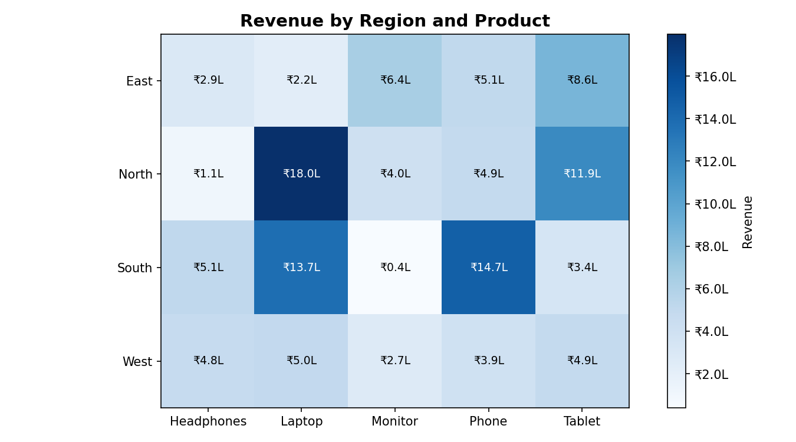
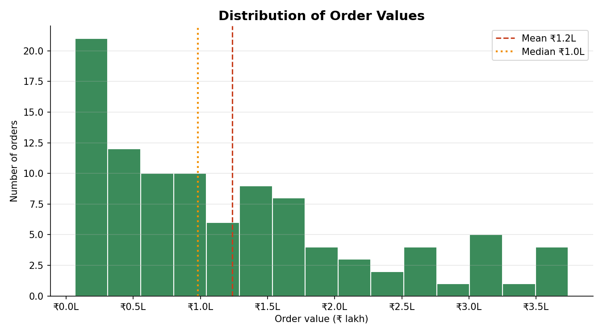

# E-commerce Sales Analysis Report

**Data:** `data/sales_data.csv` - 100 orders, 2024-01-01 to 2024-04-09

## 1. Key Metrics

| Metric | Value |
|---|---|
| Total revenue | ₹12,365,048 |
| Total orders | 100 |
| Units sold | 478 |
| Average order value | ₹123,650.48 |
| Median order value | ₹97,955.50 |
| Unique customers | 100 |
| Best-selling product (revenue) | Laptop |
| Most units sold | Laptop |
| Top region | North |
| Largest single order | ₹373,932 (Phone, 2024-01-16) |

## 2. Data Cleaning

| Check | Result |
|---|---|
| Rows in | 100 |
| Missing values before | 0 |
| Duplicates removed | 0 |
| Rows missing key fields removed | 0 |
| Invalid quantity or price removed | 0 |
| Total sales recomputed | 0 |
| Rows out | 100 |

## 3. Revenue by Product

| Product    | Revenue    |   Units |   Orders |   Share_% | Avg_Order_Value   |
|:-----------|:-----------|--------:|---------:|----------:|:------------------|
| Laptop     | ₹3,889,210 |     136 |       24 |      31.5 | ₹162,050          |
| Tablet     | ₹2,884,340 |     127 |       26 |      23.3 | ₹110,936          |
| Phone      | ₹2,859,394 |     101 |       20 |      23.1 | ₹142,970          |
| Headphones | ₹1,384,033 |      48 |       15 |      11.2 | ₹92,269           |
| Monitor    | ₹1,348,071 |      66 |       15 |      10.9 | ₹89,871           |

## 4. Monthly Trend

| Month   | Revenue    |   Orders |   Active_Days | Revenue_per_Day   |
|:--------|:-----------|---------:|--------------:|:------------------|
| 2024-01 | ₹4,120,524 |       31 |            31 | ₹132,920          |
| 2024-02 | ₹2,656,050 |       29 |            29 | ₹91,588           |
| 2024-03 | ₹4,485,006 |       31 |            31 | ₹144,678          |
| 2024-04 | ₹1,103,468 |        9 |             9 | ₹122,608          |

_April 2024 has only 9 days of data, so compare months using revenue per day._

## 5. Revenue by Region

| Region   | Revenue    |   Orders |   Share_% |
|:---------|:-----------|---------:|----------:|
| North    | ₹3,983,635 |       28 |      32.2 |
| South    | ₹3,737,852 |       27 |      30.2 |
| East     | ₹2,519,639 |       19 |      20.4 |
| West     | ₹2,123,922 |       26 |      17.2 |

## 6. Order Value Distribution

## 7. Insights

1. Laptop is the top revenue product at ₹3,889,210 (31.5% of revenue), even though Tablet had more orders (26). Laptop wins on order value (₹162,050 per order), not order count.
2. The top two products (Laptop and Tablet) bring in 54.8% of revenue. Headphones and Monitor together add only 22.1%.
3. North and South together generate 62.4% of revenue. West is the weakest region at 17.2% despite 26 orders, because its average order is only ₹81,689 vs ₹123,650 overall.
4. The strongest region-product pair is Laptop in North (₹1,798,206).
5. 2024-02 was the slowest full month: revenue per day was 37% below the best month (2024-03).
6. Average order value is ₹123,650 but the median is ₹97,956, so a few very large orders (up to ₹373,932) pull the average up.
7. Price and quantity are almost unrelated (correlation 0.008), so customers are not buying fewer units of expensive items in this data.

## 8. Recommendations

- Protect the Laptop line: keep stock and promotions focused on it, since it drives the most revenue.
- Investigate the West region - test regional offers or bundles to lift its smaller average order size.
- Bundle Headphones and Monitor with Laptop purchases to lift the two lowest-revenue categories.
- Plan a promotion for the slowest month to smooth out the dip seen in the monthly trend.
- Collect more months of data before drawing firm seasonal conclusions (only ~3 months available).

## 9. Limitations

- Only 100 orders across ~3.3 months, so trends are indicative, not conclusive.
- Every order has a different Customer_ID, so repeat-purchase behaviour cannot be analysed.
- No cost data, so this report covers revenue, not profit.
